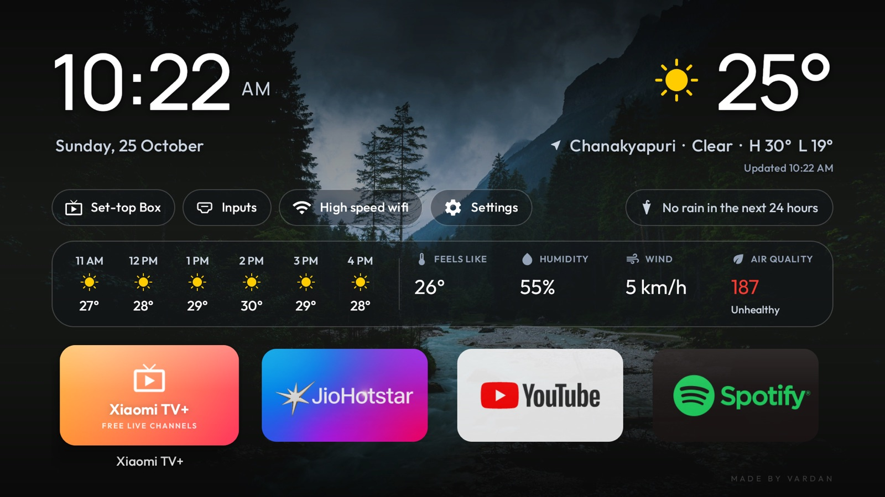
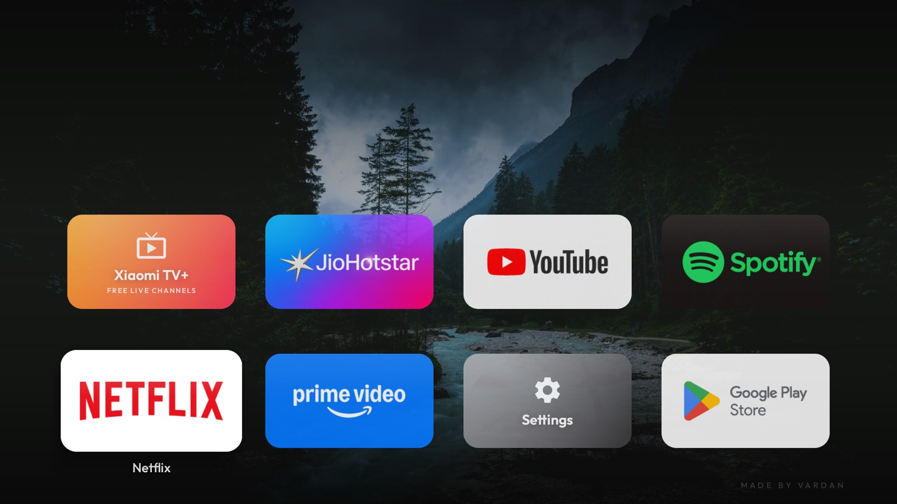
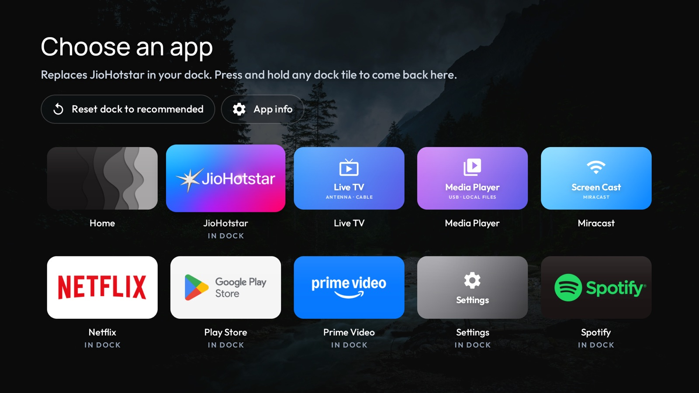
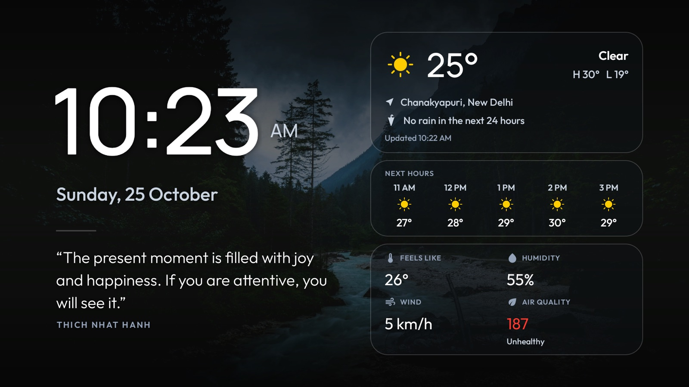

<p align="center">
  
</p>

<h1 align="center">Pure TV</h1>

<p align="center">
  A calm, Apple TV–inspired home screen for Android TV and Google TV.<br>
  No ads, no recommendation rows, no tracking. Installed from your computer in a few minutes, and fully reversible.
</p>

<p align="center">
  <a href="https://github.com/Vardxn/pure-tv/releases/latest"><b>Download the latest release</b></a> ·
  <a href="#screenshots">Screenshots</a> ·
  <a href="#install">Install</a> ·
  <a href="#undo">Undo</a> ·
  <a href="#credits">Credits</a> ·
  <a href="#support-my-work">Support</a>
</p>

<p align="center">
  <a href="https://www.buymeacoffee.com/Vardxn"></a>
</p>

---

## What you get

- **A quiet home screen.** A photo backdrop, a large clock and the date, and your apps as full-colour tiles. Nothing else competes for attention.
- **Weather that is actually useful.** The temperature, the next six hours, a warning when rain is likely in the next 24 hours, feels-like, humidity, wind and air quality. It refreshes each time you come back to Home, and never while you're watching something.
- **Instant app switching.** Apps you were just using stay warm, so going back to YouTube or Hotstar takes about 0.2 s instead of a cold start of 0.7 s or more (measured on a Xiaomi MiTV-MOOR2).
- **Your dock, your apps.** Press and hold any tile to swap in any app installed on the TV. On first launch the dock fills itself with the common apps it finds, and Settings and Play Store keep the last two slots.
- **A screensaver worth looking at.** After five minutes of no remote presses (or press Back on Home), a glass dashboard shows the time, the weather and a quote of the day. It drifts slightly every minute to protect the screen.
- **Set-top box in one press.** The first press asks which HDMI input your box is on and remembers it.

## Screenshots

All taken on a Xiaomi MiTV-MOOR2 running Pure TV.

**Home.** The clock mirrored by the weather, quick controls mirrored by the rain warning, and one glass strip with the next six hours, feels like, humidity, wind and air quality. The line under the weather shows when it was last updated.

<p align="center"></p>

**Both dock rows.** Press Down to open the second row; the top of the screen fades away so the apps have the room.

<p align="center"></p>

**Dock editor.** Press and hold any tile to put any installed app in its place. Apps already in the dock are marked.

<p align="center"></p>

**Screensaver.** After five minutes without a remote press (or press Back on Home): the time, a quote of the day, and the weather with the next hours and air quality.

<p align="center"></p>

## Install

Works on Xiaomi, TCL, Hisense, Sony, OnePlus, Realme and most other TVs running **Android TV or Google TV** (Android 8 or later). It does **not** work on Samsung (Tizen), LG (webOS) or Fire TV.

You need the TV, a computer (Mac, Windows or Linux) on the **same Wi-Fi**, and about 10 minutes. Nothing is deleted from your TV, and every change can be undone.

### Step 1 · Turn on developer mode on the TV

Open the TV's **Settings** and find the build number:

- **Xiaomi and other Google TV sets:** Settings → **System** → **About** → **Android TV OS build**
- **Older Android TV sets:** Settings → **Device Preferences** → **About** → **Build**

Select it **7 times** with the OK button until the TV says *"You are now a developer"*.

### Step 2 · Turn on USB debugging

Go back to Settings → **System** (or **Device Preferences**) → **Developer options** and switch on:

- **USB debugging**
- **Network debugging** or **ADB over network**, if your TV shows it

### Step 3 · Note the TV's IP address

Settings → **Network & Internet** → select your Wi-Fi network. Write down the **IP address**, for example `192.168.1.25`.

### Step 4 · Install Python on the computer (one time)

Download it from [python.org/downloads](https://www.python.org/downloads/) and install it. On Windows, tick **"Add python.exe to PATH"** during setup. Macs with Homebrew can run `brew install python` instead.

### Step 5 · Run one command

Replace `192.168.1.25` with your TV's address.

**Mac or Linux:** open **Terminal** and paste:

```bash
curl -fsSL https://raw.githubusercontent.com/Vardxn/pure-tv/main/install.sh | bash -s -- 192.168.1.25
```

**Windows:** open **PowerShell** and paste:

```powershell
irm https://raw.githubusercontent.com/Vardxn/pure-tv/main/install.ps1 -OutFile install.ps1; .\install.ps1 192.168.1.25
```

If Windows says scripts are disabled, run this first, then try again: `Set-ExecutionPolicy -Scope Process Bypass`

### Step 6 · Allow the connection on the TV

The TV shows **"Allow USB debugging?"**. Tick **Always allow from this computer** and press **OK**.

### Step 7 · Answer the questions

The installer backs up your TV, installs Pure TV and makes it your home screen. It then asks about a few optional extras. Our suggestions:

| Question | Suggested answer |
|---|---|
| Remote's Home button opens Pure TV (Xiaomi) | **Yes** |
| Debloat (only asked if your TV model has a tested list) | **Yes** |
| AdGuard DNS | **Your choice.** Read the table below first |
| SmartTube, YouTube without ads | **Yes**, if you watch a lot of YouTube |

### Step 8 · Enjoy, then lock the TV again

Press **Home** on the remote. Then go back to **Developer options** and switch **USB debugging** off, so no other device on your Wi-Fi can connect to the TV.

**Prefer to have AI do it?** Open [Claude Code](https://claude.com/claude-code) (or another coding assistant that can run commands), paste the prompt from [PROMPT.md](PROMPT.md), and it will do steps 5 to 7 with you.

**Something not working?** The installer explains what to check. If it still fails, [open an issue](https://github.com/Vardxn/pure-tv/issues) with your TV model and the message you saw.

### Optional extras, and what they can and can't do

| Extra | What it does | What it can't do |
|---|---|---|
| **Remote Home button** (Xiaomi) | Makes the remote's Home/PatchWall button open Pure TV, through a small accessibility service that only listens for that button. | Nothing else on the remote changes. |
| **Debloat** | Switches off preinstalled ad, tracking and promo apps, using a list tested on your TV model (from [`examples/`](examples/)). Switched off, not deleted: the TV's own Settings can turn them back on. | Only offered when there is a tested list for your model. |
| **AdGuard DNS** | Blocks known ad and tracking servers for the whole TV: banner and tracker ads in many apps, some ads in recorded shows. | **It cannot remove YouTube ads**, which come from the same servers as the videos, or ads stitched into live streams such as live cricket. Rarely, a streaming app may refuse to play or sign in; undo turns it off. |
| **SmartTube** | Installs [SmartTube](https://github.com/yuliskov/SmartTube), a free, open-source YouTube app for TVs with no ads and SponsorBlock. It sits next to the official YouTube app. | It is not made by Google; sign-in and features follow SmartTube's own releases. |

## Undo

```bash
curl -fsSL https://raw.githubusercontent.com/Vardxn/pure-tv/main/install.sh | bash -s -- rollback 192.168.1.25
```

(Windows: `.\install.ps1 rollback 192.168.1.25`.) Rollback reads the backup from your last install. It switches every app it turned off back on, restores your DNS and Home-button settings and your previous home screen, and offers to uninstall Pure TV and SmartTube.

When you're done, switch **USB debugging** off again on the TV.

## Network and privacy

Pure TV has no analytics, ads or accounts. It connects to:

- **Open-Meteo** (`api.open-meteo.com`, `air-quality-api.open-meteo.com`): the weather and air quality, each time you return to Home.
- **ipapi.co**: to find which city the TV is in, at most once a day. Not used when a location is pinned at build time.

Both over HTTPS. The installer also talks to GitHub to download releases.

## Tested on

- **Xiaomi MiTV-MOOR2** (Google TV, Android 11). Everything above, including the measurements.

It should work on most Android TV and Google TV sets running Android 8 or later (Xiaomi, TCL, Hisense, Sony, OnePlus and others), but those haven't been tested yet. If you try it on another TV, please open an issue with the model and what worked.

## Build from source

```bash
cd launcher
./gradlew assembleRelease     # JDK 17, Android SDK platform 34
```

To pin the weather to one place (a TV that never moves), add a line to `launcher/local.properties`, which is never committed:

```
weather.location=19.0760,72.8777,Mumbai
```

Release builds sign with the key configured in `~/.gradle/gradle.properties` (`PURETV_STORE_FILE`, `PURETV_STORE_PASSWORD`, `PURETV_KEY_ALIAS`, `PURETV_KEY_PASSWORD`); without it they use the debug key. Install a build with `./install.sh install <tv-ip> --apk launcher/app/build/outputs/apk/release/app-release.apk`.

Screensaver quotes live in [`quotes.txt`](launcher/app/src/main/res/raw/quotes.txt).

## Support my work

Pure TV is free and open source, and I build and test it in my spare time. If it made your TV, or your evenings, a little better, you can buy me a coffee:

<a href="https://www.buymeacoffee.com/Vardxn"></a>

**[buymeacoffee.com/Vardxn](https://www.buymeacoffee.com/Vardxn)**

In India, you can also pay by UPI: **`8279696707@yescred`** (any UPI app: Google Pay, PhonePe, Paytm, BHIM).

Not in a position to give? A ⭐ on this repo, a bug report, or trying Pure TV on a new TV model and [telling me how it went](https://github.com/Vardxn/pure-tv/issues) helps just as much.

And please consider supporting [cleanyourtv](https://github.com/Gathin23/cleanyourtv) too: Pure TV wouldn't exist without it.

## Credits

Pure TV is built on **[cleanyourtv](https://github.com/Gathin23/cleanyourtv)** by [Gathin23](https://github.com/Gathin23) and its contributors: the original launcher, the debloat lists in `examples/`, and the network ADB tools in `tools/`. If you want a small, offline, no-network launcher, use theirs. Pure TV is a restyle with weather, a screensaver and an installer on top.

Wallpaper photograph: river valley by [Karsten Würth](https://unsplash.com/photos/7BjhtdogU3A) on [Unsplash](https://unsplash.com/license).

Weather and air quality from [Open-Meteo](https://open-meteo.com/) (CC BY 4.0).

## License

[MIT](LICENSE), like the project it is built on.
